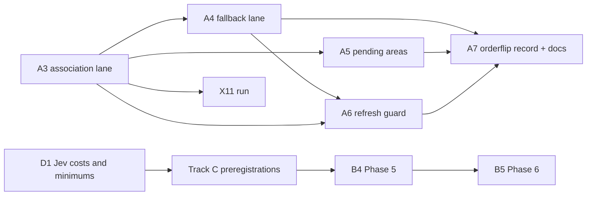

# Remaining work (2026-11-06)

This is the single list of Scout work still to do. It replaces `HANDOFF.md` (deleted) and the remaining-work table that used to be `docs/STATUS.md` §5. The detailed specifications stay where they are, and this plan points to them:

- design §11 (product phases) and §13 (experiments) in `docs/scout-design.md`;
- the per-phase specification in `docs/plans/2026-11-01-rev-2.8-merge-association.md`.

Where this plan and the design differ, the design wins. Machine setup, accounts and the repository gate are in `CONTRIBUTING.md`.

## Where things stand

| Area                                  | State                                                                                                                                         | Evidence                                                                     |
| ------------------------------------- | --------------------------------------------------------------------------------------------------------------------------------------------- | ---------------------------------------------------------------------------- |
| Design                                | Revision 2.8 adopted, SHA-256 `d1fb1274…9b75`                                                                                                 | `docs/STATUS.md` §1; `docs/design-reviews/2026-10-31-jev-merge-association/` |
| Product roadmap (design §11)          | Phases 1–4 done, with three open items (track B)                                                                                              | `docs/STATUS.md` §1                                                          |
| Merge-time association (rev 2.8 plan) | Phases 0–2 done (`1d4e0cc`, `3e89f23`); the lane is not wired into `scout assess` yet                                                         | `docs/STATUS.md` §1                                                          |
| Repository gate                       | Gate schema v2: the pre-commit hook runs `checks.commit`, the required CI check `gate` runs `checks.ci`, and `main` is protected (`5776d102`) | `.omp/gate.json`; `CONTRIBUTING.md`                                          |
| Toolchain                             | Go 1.26.10, Clawpatch 0.7.3                                                                                                                   | `toolchain/versions.env`                                                     |

Two phase series exist. Track A numbers follow the rev 2.8 plan (A3–A7), and track B numbers follow design §11 (Phases 3–6). They are different phases.

## Track A: merge-time association (rev 2.8 plan Phases 3–7)

The lane ships off by default as a provisional opt-in. The fastapi result did not replicate on axum (P_assign 0.922 vs 0.622, R-061).

| #   | Work                                                                                                                                                                                                                                                                                                                                                                                                                                                                                                                                                                                                                                                                                                                                               | Acceptance                                                                                                                                                                                                                                                                                                                                                                                                                                                                                                                                                                              | Depends on              |
| --- | -------------------------------------------------------------------------------------------------------------------------------------------------------------------------------------------------------------------------------------------------------------------------------------------------------------------------------------------------------------------------------------------------------------------------------------------------------------------------------------------------------------------------------------------------------------------------------------------------------------------------------------------------------------------------------------------------------------------------------------------------- | --------------------------------------------------------------------------------------------------------------------------------------------------------------------------------------------------------------------------------------------------------------------------------------------------------------------------------------------------------------------------------------------------------------------------------------------------------------------------------------------------------------------------------------------------------------------------------------- | ----------------------- |
| A3  | **`association` lane (Jev).**  1. Register `merge.covered@v1` and `merge.which_area@v1` with the pilot's frozen question text and criteria (`evaluation/x2d-merge-association-pilot/questions/`).  2. Add the `mapping.association.*` policy keys.  3. Add a push-only optional lane with `requires: decision-egress`.  4. Wire `association.Run` into `scout assess`.  5. Add a store-backed `association.Ownership` with all four methods (`AreaOwners`, which must include association-derived owners, `PendingAreas`, `HeuristicOnly`, `SiblingFiles`). Phase 2 has only the `overlay` wrapper and a test fixture.  6. Call `Decider` once per merge, and map results to `domain.Association`.  7. Add staleness marking. | Replay of the saved fastapi rounds 8–10 scores (`evaluation/x2d-merge-association-pilot/data/postrun/rounds/{8,9,10}/jev/scores.jsonl`) gives **64/67 assigned correct and 10/92 unresolved**. Per round that is 14/14, 8/10 and 42/43. Settings: covered score 0.60 (`none` when P(true) ≤ 0.40), `t_choice` 0.535, and a second permutation when `sha256("x2d-flip"+cluster) mod 5 == 0`. A recomputation on 2026-11-06 reproduced these numbers exactly. The pilot's provisional `thresholds.json` (0.70) is not the frozen setting. The plan's scenario and test list also applies. | —                       |
| A4  | **`association-fallback` lane** (`codex exec -m gpt-6.1-terra`, effort high). Its prompt is `evaluation/x2d-postrun-tuning/terra_prompt_v1.txt`, digest-checked. Consent is captured in `scout init`.                                                                                                                                                                                                                                                                                                                                                                                                                                                                                                                                              | Replay with a fake `codex` gives **71/77**, 0 unresolved, and 13 pending on gold-`none`.                                                                                                                                                                                                                                                                                                                                                                                                                                                                                                | A3                      |
| A5  | **Pending areas:** `scout areas list --pending`, `accept` and `merge`. Follow the `scout triage --actor/--reason/--authorize` pattern.                                                                                                                                                                                                                                                                                                                                                                                                                                                                                                                                                                                                             | Plan Phase 5                                                                                                                                                                                                                                                                                                                                                                                                                                                                                                                                                                            | A3 (state from Phase 1) |
| A6  | **Refresh guard** (`internal/association/guard.go`). Its defaults (20/20/0.40/0.20) are assumptions.                                                                                                                                                                                                                                                                                                                                                                                                                                                                                                                                                                                                                                               | Plan Phase 6                                                                                                                                                                                                                                                                                                                                                                                                                                                                                                                                                                            | A3, A4                  |
| A7  | **Release gate:** wire `orderflip`, record the `merge.which_area` flip rate in `docs/jev-adapter-audit.md` (B-3), and update the docs and changelog. No release may enable the lane before this is done.                                                                                                                                                                                                                                                                                                                                                                                                                                                                                                                                           | Plan Phase 7                                                                                                                                                                                                                                                                                                                                                                                                                                                                                                                                                                            | A3–A6                   |

Each phase also needs `go test ./...`, the commit hook, its phase scenario, and a record in `docs/STATUS.md` §1.

## Track B: product roadmap (design §11)

| #   | Work                                                                                                                               | Entry condition                     | Notes                                                                                                                                                                                                                                                                  |
| --- | ---------------------------------------------------------------------------------------------------------------------------------- | ----------------------------------- | ---------------------------------------------------------------------------------------------------------------------------------------------------------------------------------------------------------------------------------------------------------------------- |
| B1  | Phase 3 CI item: observe `pr_effort` in a trusted default-branch CI run                                                            | a trusted run on `main`             | Wired already (`scout-guardian-trusted.yml`, `pull-requests: read`) but never observed                                                                                                                                                                                 |
| B2  | Re-run Phase 4 under the rev 2.6 acceptance on fastapi `d666ccb` and axum `562fa20`, and record the result in `docs/STATUS.md` §1  | `ead1a3f` (done)                    | The scenario script `/tmp/scout-p4/scenario.sh` was lost with the old machine. Rebuild it against the amended acceptance.                                                                                                                                              |
| B3  | Phase 3b: the exact schema for the subject interface                                                                               | inertia-bench design signed off     | Needs its own council round                                                                                                                                                                                                                                            |
| B4  | Phase 5: trends, exploratory measures, the rubric lane, self-evaluation, and agent-labelled eval data                              | track C preregistrations signed off | Design §11 Phase 5                                                                                                                                                                                                                                                     |
| B5  | Phase 6: study export (the dogfood ledger is dataset #1), web inertia panels, release, dogfood in `guardian`, and the spec cutover | B4                                  | The spec cutover archives `SCOUT_REBUILD_REQUIREMENTS.md` under `docs/evidence/` and writes `docs/scout-product-contract.md` and `docs/scout-adapter-contracts.md`. The same council round should move `docs/enaible-findings.md` to `docs/evidence/` and update R-002 |

## Track C: experiments that need a council-signed preregistration

None of these is preregistered yet. Each one follows the experiment rules in `CLAUDE.md`: preregister, plant an effect and a null, get council sign-off with zero issues, then freeze.

| ID              | Question (design §13)                                                        | Feeds                             |
| --------------- | ---------------------------------------------------------------------------- | --------------------------------- |
| X1              | Jev ranking vs deterministic ranking                                         | B4; design assumption A4          |
| X3, X4, X5, X10 | Phase 5 measures, the rubric lane and self-evaluation                        | B4                                |
| X6              | Replay of unwarranted guardrail blocks                                       | allow-list promotion              |
| X9              | Hand-check of 200 `moved/pasted/new` labels and 200 `stale_reference` labels | B4                                |
| X11             | Merge-time association plus the refresh guard (tests HD8)                    | upgrades track A from provisional |

HD6b and HD7 are `proposed` and have no test yet (`docs/hypothesis-ledger.md`).

## Owner decisions

| #   | Decision                                                                                                                                                                     | Blocks                                                      |
| --- | ---------------------------------------------------------------------------------------------------------------------------------------------------------------------------- | ----------------------------------------------------------- |
| D1  | Jev false-action costs and per-decision minimums (design §15 item 1). The provisional defaults 0.8/0.8, raised to 0.9 on the costlier side, are in force until you set them. | the minimums in the X1, X3, X4, X5 and X10 preregistrations |

## Known gaps (from `docs/STATUS.md` §1)

- When agent mapping succeeds with zero features, the heuristic output is not re-merged.
- An issue left unmatched during a rename keeps its old anchor path.
- The policy `version` strings for Gitleaks checks are the long rule-pack version.
- The shadow-window bound (`unknown` ≤ 10 % of PR runs) cannot be computed yet. `ShadowStats` has no producer, and `comparison` is not persisted (design §7.2).

## Corrections that need a council round (design rule 1)

These are stale statements in governed text. They need a design review round, not a direct edit:

- The design's status line says "Nothing of revision 2.8 is implemented yet". Plan Phases 0–2 are done.
- The design's status line says the dogfood caller pins `v0.1.4`. It now pins `v0.1.6` (`.github/workflows/scout-nightly.yml`).

## Candidate source (not in the ledger)

MOSS, arXiv:2610.26902: an LLM-judge monitoring loop whose thresholds transferred across benchmarks. It may matter for X1 and nightly mode. Read the full paper before using it. If it informs a decision, record it as R-062.

## What this tidy-up changed

- **Deleted:** `HANDOFF.md`, the 2026-11-04 machine-migration handoff. Its setup and account notes moved to `CONTRIBUTING.md`, and its remaining work moved here. Its migration checks (branches, worktrees, stash) were one-time and are complete.
- **Kept, governed:**
  - `SCOUT_REBUILD_REQUIREMENTS.md` stays in the repository root. It is the live product spec until the Phase 6 cutover (B5), and the design cites it by path.
  - `docs/scout-allowlist.md` and `docs/jev-adapter-audit.md` are adopted or cited by the design.
- **Kept, cited as evidence:**
  - `docs/scout-design-brief.md`, `docs/inertia-research.md` and `docs/archive/scout-design-v1.md` are cited by the design or by review records.
  - `docs/enaible-findings.md` is cited by R-002; it moves in B5.
- **Kept as the per-phase specification:** `docs/plans/2026-11-01-rev-2.8-merge-association.md`. The design review rounds cite it.
- `docs/STATUS.md` keeps current state, evidence and decisions. Its remaining-work section now points here.
