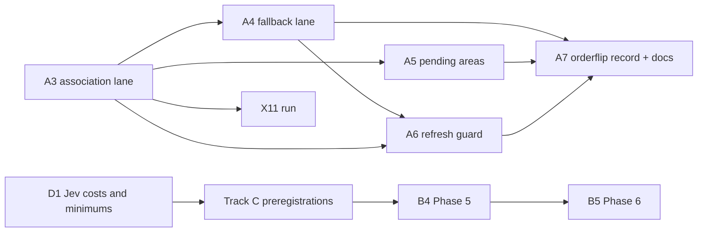

# Remaining work (2026-11-06)

This is the single list of Scout work still to do. It replaces `HANDOFF.md` (deleted) and the former remaining-work table in `docs/STATUS.md`. The detailed specifications stay where they are, and this plan points to them:

- product requirements and experiments in `docs/scout-design.html` Appendix A (REQ-1…REQ-183);
- the per-phase specification in `docs/plans/2026-11-01-rev-2.8-merge-association.md`.

Where this plan and the design differ, the design wins. Machine setup, accounts and the repository gate are in `CONTRIBUTING.md`.

## Where things stand

| Area                                                | State                                                                                                                                         | Evidence                                         |
| --------------------------------------------------- | --------------------------------------------------------------------------------------------------------------------------------------------- | ------------------------------------------------ |
| Design                                              | `docs/scout-design.html`, ADR-009 adopted 2026-11-06                                                                                          | `docs/adrs/2026-11-06-design-restructure/ADR.md` |
| Product roadmap (REQ-167, REQ-168, REQ-178–REQ-182) | Phases 1–4 done; B1 observed (still unmeasured), B2 rerun passed; B3–B5 remain open                                                           | `docs/STATUS.md` §1                              |
| Merge-time association (rev 2.8 plan)               | Phases 0–7 done (A3–A7); default-off provisional opt-in                                                                                       | `docs/STATUS.md` §1; `CHANGELOG.md`              |
| Repository gate                                     | Gate schema v2: the pre-commit hook runs `checks.commit`, the required CI check `gate` runs `checks.ci`, and `main` is protected (`5776d102`) | `.omp/gate.json`; `CONTRIBUTING.md`              |
| Toolchain                                           | Go 1.26.10, Clawpatch 0.7.3                                                                                                                   | `toolchain/versions.env`                         |

Two phase series exist. Track A numbers follow the rev 2.8 plan (A3–A7), and track B numbers follow the product roadmap (REQ-167, REQ-168, REQ-180–REQ-182; Phases 3–6). They are different phases.

## Track A: merge-time association (rev 2.8 plan Phases 3–7)

The lane ships off by default as a provisional opt-in. The fastapi result did not replicate on axum (P_assign 0.922 vs 0.622, R-061).

| #   | Work                                                                                                                                                   | Acceptance / evidence                                                                                                                                                                                                               | Depends on              |
| --- | ------------------------------------------------------------------------------------------------------------------------------------------------------ | ----------------------------------------------------------------------------------------------------------------------------------------------------------------------------------------------------------------------------------- | ----------------------- |
| A3  | **Done: `association` lane (Jev).** Frozen questions, policy, push-only lane, store-backed ownership and staleness marking.                            | Plan Phase 3; `docs/STATUS.md` §1: saved fastapi rounds 8–10 replay gives 64/67 assigned correct, 10/92 unresolved (covered score 0.60, `t_choice` 0.535, 20 % hash-selected second permutation); fixture assess scenario recorded. | —                       |
| A4  | **Done: `association-fallback` lane** (`codex exec -m gpt-6.1-terra`, effort high), digest-checked pilot prompt and separate consent.                  | Plan Phase 4; `docs/STATUS.md` §1: replay gives 71/77, 0 unresolved, 13 pending on gold-`none`; fake-codex and absent-codex scenarios recorded.                                                                                     | A3                      |
| A5  | **Done: pending areas:** `scout areas list --pending`, `accept` and `merge`, with maintainer authorization and audit trail.                            | Plan Phase 5; `docs/STATUS.md` §1: accepted-pending map-refresh scenario.                                                                                                                                                           | A3 (state from Phase 1) |
| A6  | **Done: refresh guard** (`internal/association/guard.go`). Defaults (20/20/0.40/0.20) remain assumptions.                                              | Plan Phase 6; `docs/STATUS.md` §1: 25-merge history trips the flag, completed map clears it without changing labels or running a map CLI.                                                                                           | A3, A4                  |
| A7  | **Done 2026-11-07: release gate and docs.** `scout decisions orderflip`, B-3 record, references and changelog; lane stays default-off and provisional. | Plan Phase 7; `docs/jev-adapter-audit.md` row 30 / B-3: 11/92 flipped (0.1196), 0 unmeasured; `docs/STATUS.md` §1; `CHANGELOG.md`. REQ-99 requires the record before a release enables association, not a pass/fail threshold.      | A3–A6                   |

Each phase also needs `go test ./...`, the commit hook, its phase scenario, and a record in `docs/STATUS.md` §1.

## Track B: product roadmap (REQ-167, REQ-168, REQ-180–REQ-182)

| #   | Work                                                                                                         | Entry condition                     | Notes                                                                                                                                         |
| --- | ------------------------------------------------------------------------------------------------------------ | ----------------------------------- | --------------------------------------------------------------------------------------------------------------------------------------------- |
| B1  | **Done (observed 2026-11-07):** `scout.pr_effort` published in trusted default-branch CI                     | a trusted run on `main`             | Still `unmeasured` on every snapshot; metadata wiring works, ≥ 5 linked merged PRs per scope needed. Counts and commits: `docs/STATUS.md` §1. |
| B2  | **Done 2026-11-07:** Phase 4 rev 2.6 rerun, PASS on fastapi `d666ccb` and axum `562fa20`                     | `ead1a3f` (done)                    | Scout `8d01f6c2`, real Clawpatch/codex maps; supersedes pre-2.6 run. Results and throwaway harness provenance: `docs/STATUS.md` §1.           |
| B3  | Phase 3b: the exact schema for the subject interface                                                         | inertia-bench design signed off     | Needs its own council round                                                                                                                   |
| B4  | Phase 5: trends, exploratory measures, the rubric lane, self-evaluation, and agent-labelled eval data        | track C preregistrations signed off | REQ-34, REQ-67–REQ-69, REQ-108–REQ-110, REQ-123–REQ-124, REQ-136–REQ-138, REQ-182                                                             |
| B5  | Phase 6: study export (the dogfood ledger is dataset #1), web inertia panels, release, dogfood in `guardian` | B4                                  | REQ-36, REQ-168. The spec cutover is done by ADR-009.                                                                                         |

## Track C: experiments that need a council-signed preregistration

None of these is preregistered yet. Each one follows the experiment rules in `CLAUDE.md`: preregister, plant an effect and a null, get council sign-off with zero issues, then freeze.

| ID              | Question (REQ-169–REQ-177)                                                   | Feeds                             |
| --------------- | ---------------------------------------------------------------------------- | --------------------------------- |
| X1              | Jev ranking vs deterministic ranking                                         | B4; REQ-169                       |
| X3, X4, X5, X10 | Phase 5 measures, the rubric lane and self-evaluation                        | B4                                |
| X6              | Replay of unwarranted guardrail blocks                                       | allow-list promotion              |
| X9              | Hand-check of 200 `moved/pasted/new` labels and 200 `stale_reference` labels | B4                                |
| X11             | Merge-time association plus the refresh guard (tests HD8)                    | upgrades track A from provisional |

HD6b and HD7 are `proposed` and have no test yet (`docs/hypothesis-ledger.md`).

## Owner decisions

| #   | Decision                                                                                                                                                          | Blocks                                                      |
| --- | ----------------------------------------------------------------------------------------------------------------------------------------------------------------- | ----------------------------------------------------------- |
| D1  | Jev false-action costs and per-decision minimums (REQ-98). The provisional defaults 0.8/0.8, raised to 0.9 on the costlier side, are in force until you set them. | the minimums in the X1, X3, X4, X5 and X10 preregistrations |

## Known gaps (from `docs/STATUS.md` §1)

- When agent mapping succeeds with zero features, the heuristic output is not re-merged.
- An issue left unmatched during a rename keeps its old anchor path.
- The policy `version` strings for Gitleaks checks are the long rule-pack version.
- The shadow-window bound (`unknown` ≤ 10 % of PR runs) cannot be computed yet. `ShadowStats` has no producer, and `comparison` is not persisted (REQ-22, REQ-78).

## Candidate source (not in the ledger)

MOSS, arXiv:2610.26902: an LLM-judge monitoring loop whose thresholds transferred across benchmarks. It may matter for X1 and nightly mode. Read the full paper before using it. If it informs a decision, record it under the next free research-ledger ID.

## Docs that stay

- **Governed design:** `docs/scout-design.html`. Appendix A holds REQ-1…REQ-183; Appendix B indexes ADR-000…ADR-009.
- **Decisions and review evidence:** `docs/adrs/`, indexed by `docs/adrs/README.md`.
- **Reference:** `docs/references/` describes the CLI, lanes, policy, environment and CI.
- **Plans:** `docs/plans/` keeps this remaining-work list and the per-phase merge-association specification.
- **Current state:** `docs/STATUS.md` keeps code/phase state, evidence and resume pointers.
- **Ledgers:** `docs/research-ledger.md` and `docs/hypothesis-ledger.md` keep sources and hypothesis state.
- **Jev audit:** `docs/jev-adapter-audit.md` keeps the adapter audit and open design-level gaps.
- **Deleted by ADR-009:** `docs/scout-design.md`, `SCOUT_REBUILD_REQUIREMENTS.md`, `docs/scout-allowlist.md`, `docs/archive/`, `docs/scout-design-brief.md`, `docs/inertia-research.md` and `docs/enaible-findings.md`. Git keeps their history.
- `HANDOFF.md` was deleted in the earlier tidy-up. Its setup and account notes moved to `CONTRIBUTING.md`, and its remaining work moved here.
