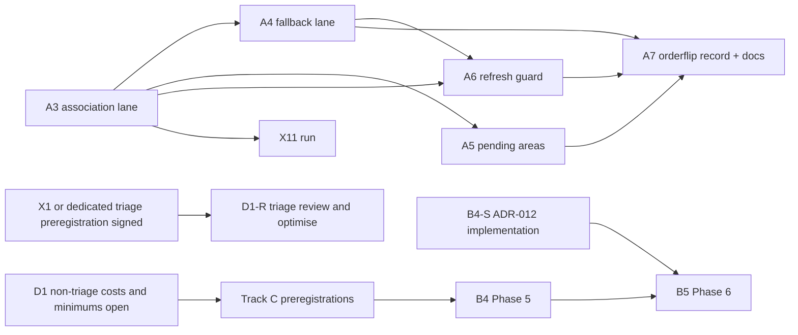

# Remaining work (2026-11-06)

This is the single list of Scout work still to do. It replaces `HANDOFF.md` (deleted) and the former remaining-work table in `docs/STATUS.md`. The detailed specifications stay where they are, and this plan points to them:

- product requirements and experiments in `docs/scout-design.html` Appendix A (REQ-1…REQ-183);
- the per-phase specification in `docs/plans/2026-11-01-rev-2.8-merge-association.md`.

Where this plan and the design differ, the design wins. Machine setup, accounts and the repository gate are in `CONTRIBUTING.md`.

## Where things stand

| Area                                                | State                                                                                                                                                     | Evidence                                         |
| --------------------------------------------------- | --------------------------------------------------------------------------------------------------------------------------------------------------------- | ------------------------------------------------ |
| Design                                              | `docs/scout-design.html`, ADR-009 adopted 2026-11-06                                                                                                      | `docs/adrs/2026-11-06-design-restructure/ADR.md` |
| Product roadmap (REQ-167, REQ-168, REQ-178–REQ-182) | Phases 1–4 done; B1 observed (still unmeasured), B2 rerun passed; B3–B5 and B4-S remain open                                                              | `docs/STATUS.md` §1                              |
| Merge-time association (rev 2.8 plan)               | Phases 0–7 done (A3–A7); default-off provisional opt-in                                                                                                   | `docs/STATUS.md` §1; `CHANGELOG.md`              |
| Repository gate                                     | The pre-commit hook runs `bash scripts/gate.sh commit`, the required CI check `gate` runs `bash scripts/gate.sh ci`, and `main` is protected (`5776d102`) | `scripts/gate/`; `CONTRIBUTING.md`               |
| Toolchain                                           | Go 1.26.11, Clawpatch 0.7.3                                                                                                                               | `toolchain/versions.env`                         |

Two phase series exist. Track A numbers follow the rev 2.8 plan (A3–A7), and track B numbers follow the product roadmap (REQ-167, REQ-168, REQ-180–REQ-182; Phases 3–6). They are different phases.

## Track A: merge-time association (rev 2.8 plan Phases 3–7)

The lane ships off by default as a provisional opt-in. The fastapi result did not replicate on axum (P_assign 0.922 vs 0.622, R-061).

| #   | Work                                                                                                                                                   | Acceptance / evidence                                                                                                                                                                                                               | Depends on              |
| --- | ------------------------------------------------------------------------------------------------------------------------------------------------------ | ----------------------------------------------------------------------------------------------------------------------------------------------------------------------------------------------------------------------------------- | ----------------------- |
| A3  | **Done: `association` lane (Jev).** Frozen questions, policy, push-only lane, store-backed ownership and staleness marking.                            | Plan Phase 3; `docs/STATUS.md` §1: saved fastapi rounds 8–10 replay gives 64/67 assigned correct, 10/92 unresolved (covered score 0.60, `t_choice` 0.535, 20 % hash-selected second permutation); fixture assess scenario recorded. | —                       |
| A4  | **Done: `association-fallback` lane** (`codex exec -m gpt-6.1-terra`, effort high), digest-checked pilot prompt and separate consent.                  | Plan Phase 4; `docs/STATUS.md` §1: replay gives 71/77, 0 unresolved, 13 pending on gold-`none`; fake-codex and absent-codex scenarios recorded.                                                                                     | A3                      |
| A5  | **Done: pending areas:** `scout areas list --pending`, `accept` and `merge`, with maintainer authorization and audit trail.                            | Plan Phase 5; `docs/STATUS.md` §1: accepted-pending map-refresh scenario.                                                                                                                                                           | A3 (state from Phase 1) |
| A6  | **Done: refresh guard** (`internal/association/guard.go`). Defaults (20/20/0.40/0.20) remain assumptions.                                              | Plan Phase 6; `docs/STATUS.md` §1: 25-merge history trips the flag, completed map clears it without changing labels or running a map CLI.                                                                                           | A3, A4                  |
| A7  | **Done 2026-11-07: release gate and docs.** `scout decisions orderflip`, B-3 record, references and changelog; lane stays default-off and provisional. | Plan Phase 7; `docs/jev-adapter-audit.md` row 30 / B-3: 11/92 flipped (0.1196), 0 unmeasured; `docs/STATUS.md` §1; `CHANGELOG.md`. REQ-99 requires the record before a release enables association, not a pass/fail threshold.      | A3–A6                   |

Each phase also needs `go test ./...`, the commit hook, its phase scenario, and a record in `docs/STATUS.md` §1.

## Track B: product roadmap (REQ-167, REQ-168, REQ-180–REQ-182)

| #    | Work                                                                                                                                                                                                           | Entry condition                                                                        | Notes                                                                                                                                                                                                                                                                                                                                                                                                                                                                                                                                                                                                                                                                                                                                                                                                                                                                                                                                                                                                                                                                                                                                                                                                                                                                                                                                                                                                                                                                                                                                                                                                                                                                                                                                                                                                                                                                                                                                                                                                                                                                                                                                                                                                                                                                                                                                                                                                                                                                                                                                                                                                                                                                                                                                                                                                                                                                                                                                                                                                                                                                                                                                                                                                                                                                                                                                                                                                                                                                                                                                                                                                                                                                                                                                                                                                                                                                                                                                                                                                                                                                                                                                                                                                                                                                                                                                                                                                                                                                                                                                                                                                                                                                                                                                                                                                                                                                                                                                                                                                                                                                                                                                                                                                                                                                                                                                                                                                                                                                                                                                                                                                      |
| ---- | -------------------------------------------------------------------------------------------------------------------------------------------------------------------------------------------------------------- | -------------------------------------------------------------------------------------- | ---------------------------------------------------------------------------------------------------------------------------------------------------------------------------------------------------------------------------------------------------------------------------------------------------------------------------------------------------------------------------------------------------------------------------------------------------------------------------------------------------------------------------------------------------------------------------------------------------------------------------------------------------------------------------------------------------------------------------------------------------------------------------------------------------------------------------------------------------------------------------------------------------------------------------------------------------------------------------------------------------------------------------------------------------------------------------------------------------------------------------------------------------------------------------------------------------------------------------------------------------------------------------------------------------------------------------------------------------------------------------------------------------------------------------------------------------------------------------------------------------------------------------------------------------------------------------------------------------------------------------------------------------------------------------------------------------------------------------------------------------------------------------------------------------------------------------------------------------------------------------------------------------------------------------------------------------------------------------------------------------------------------------------------------------------------------------------------------------------------------------------------------------------------------------------------------------------------------------------------------------------------------------------------------------------------------------------------------------------------------------------------------------------------------------------------------------------------------------------------------------------------------------------------------------------------------------------------------------------------------------------------------------------------------------------------------------------------------------------------------------------------------------------------------------------------------------------------------------------------------------------------------------------------------------------------------------------------------------------------------------------------------------------------------------------------------------------------------------------------------------------------------------------------------------------------------------------------------------------------------------------------------------------------------------------------------------------------------------------------------------------------------------------------------------------------------------------------------------------------------------------------------------------------------------------------------------------------------------------------------------------------------------------------------------------------------------------------------------------------------------------------------------------------------------------------------------------------------------------------------------------------------------------------------------------------------------------------------------------------------------------------------------------------------------------------------------------------------------------------------------------------------------------------------------------------------------------------------------------------------------------------------------------------------------------------------------------------------------------------------------------------------------------------------------------------------------------------------------------------------------------------------------------------------------------------------------------------------------------------------------------------------------------------------------------------------------------------------------------------------------------------------------------------------------------------------------------------------------------------------------------------------------------------------------------------------------------------------------------------------------------------------------------------------------------------------------------------------------------------------------------------------------------------------------------------------------------------------------------------------------------------------------------------------------------------------------------------------------------------------------------------------------------------------------------------------------------------------------------------------------------------------------------------------------------------------------------------------------------- |
| B1   | **Done (observed 2026-11-07):** `scout.pr_effort` published in trusted default-branch CI                                                                                                                       | a trusted run on `main`                                                                | Still `unmeasured` on every snapshot; metadata wiring works, ≥ 5 linked merged PRs per scope needed. Counts and commits: `docs/STATUS.md` §1.                                                                                                                                                                                                                                                                                                                                                                                                                                                                                                                                                                                                                                                                                                                                                                                                                                                                                                                                                                                                                                                                                                                                                                                                                                                                                                                                                                                                                                                                                                                                                                                                                                                                                                                                                                                                                                                                                                                                                                                                                                                                                                                                                                                                                                                                                                                                                                                                                                                                                                                                                                                                                                                                                                                                                                                                                                                                                                                                                                                                                                                                                                                                                                                                                                                                                                                                                                                                                                                                                                                                                                                                                                                                                                                                                                                                                                                                                                                                                                                                                                                                                                                                                                                                                                                                                                                                                                                                                                                                                                                                                                                                                                                                                                                                                                                                                                                                                                                                                                                                                                                                                                                                                                                                                                                                                                                                                                                                                                                              |
| B2   | **Done 2026-11-07:** Phase 4 rev 2.6 rerun, PASS on fastapi `d666ccb` and axum `562fa20`                                                                                                                       | `ead1a3f` (done)                                                                       | Scout `8d01f6c2`, real Clawpatch/codex maps; supersedes pre-2.6 run. Results and throwaway harness provenance: `docs/STATUS.md` §1.                                                                                                                                                                                                                                                                                                                                                                                                                                                                                                                                                                                                                                                                                                                                                                                                                                                                                                                                                                                                                                                                                                                                                                                                                                                                                                                                                                                                                                                                                                                                                                                                                                                                                                                                                                                                                                                                                                                                                                                                                                                                                                                                                                                                                                                                                                                                                                                                                                                                                                                                                                                                                                                                                                                                                                                                                                                                                                                                                                                                                                                                                                                                                                                                                                                                                                                                                                                                                                                                                                                                                                                                                                                                                                                                                                                                                                                                                                                                                                                                                                                                                                                                                                                                                                                                                                                                                                                                                                                                                                                                                                                                                                                                                                                                                                                                                                                                                                                                                                                                                                                                                                                                                                                                                                                                                                                                                                                                                                                                        |
| B3   | Phase 3b: the exact schema for the subject interface                                                                                                                                                           | inertia-bench design signed off                                                        | Needs its own council round                                                                                                                                                                                                                                                                                                                                                                                                                                                                                                                                                                                                                                                                                                                                                                                                                                                                                                                                                                                                                                                                                                                                                                                                                                                                                                                                                                                                                                                                                                                                                                                                                                                                                                                                                                                                                                                                                                                                                                                                                                                                                                                                                                                                                                                                                                                                                                                                                                                                                                                                                                                                                                                                                                                                                                                                                                                                                                                                                                                                                                                                                                                                                                                                                                                                                                                                                                                                                                                                                                                                                                                                                                                                                                                                                                                                                                                                                                                                                                                                                                                                                                                                                                                                                                                                                                                                                                                                                                                                                                                                                                                                                                                                                                                                                                                                                                                                                                                                                                                                                                                                                                                                                                                                                                                                                                                                                                                                                                                                                                                                                                                |
| B4   | Phase 5: trends, exploratory measures, the rubric lane, self-evaluation, and agent-labelled eval data                                                                                                          | track C preregistrations signed off                                                    | REQ-34, REQ-67–REQ-69, REQ-108–REQ-110, REQ-123–REQ-124, REQ-136–REQ-138, REQ-182                                                                                                                                                                                                                                                                                                                                                                                                                                                                                                                                                                                                                                                                                                                                                                                                                                                                                                                                                                                                                                                                                                                                                                                                                                                                                                                                                                                                                                                                                                                                                                                                                                                                                                                                                                                                                                                                                                                                                                                                                                                                                                                                                                                                                                                                                                                                                                                                                                                                                                                                                                                                                                                                                                                                                                                                                                                                                                                                                                                                                                                                                                                                                                                                                                                                                                                                                                                                                                                                                                                                                                                                                                                                                                                                                                                                                                                                                                                                                                                                                                                                                                                                                                                                                                                                                                                                                                                                                                                                                                                                                                                                                                                                                                                                                                                                                                                                                                                                                                                                                                                                                                                                                                                                                                                                                                                                                                                                                                                                                                                          |
| B4-S | Implement ADR-012 CI facts, maintainer triage history and read-only readiness; choose wiring under its invariants. Requirement-changing wiring first needs its own adopted zero-issue wiring ADR under REQ-161 | final adopted ADR-012 on adopted ADR-011 bytes and, where required, adopted wiring ADR | Prove all [ADR-012 acceptance invariants](../adrs/2026-11-08-shadow-readiness-inputs/ADR.md#implementation-acceptance-invariants), not just a refusal. Required fixtures: clearing last Undecided refuses/exit 2 until C reaches stamp, then ready/exit 0; frontier-only quiet reconcile computes; another-check post-C triage does not refuse; late post-C record while an in-flight attempt holds C gives refused/exit 2, while --as-of C has the same digest/historical status. Day25/day32 cross-lineage verdicts in both orders remain Undecided until an authorized destination verdict after the last import publication, which restores ready; multi-row imports keep one row/event/publication, repeated import is a no-op, sealed local fast-forward equals fresh restore. At historical day30, independently assert that a same-pin/different-inspection late rerun preserves the representative, and a different-pin late rerun preserves the default version; cohort/digest stay identical before pending import, after pending import and after publication. A day20 point ends the interval so day35 interval/Days origin starts after it. Manual cancel then later push is assessed/gapped; approval-waiting fork cannot hold C, and deadline-expired job is point-gapped, then C advances past started_at before terminal publication, whose facts must be late/invisible before stamp. With C≥terminal stamp and no refusal trigger, assert the late terminal attempt and its linked would_block event are visible, yielding computed exit 0 not-ready/Undecided, paired with an otherwise identical ready control without the late terminal facts. Late would_block, imported not_warranted and skewed-clock correction veto fixtures advance C≥all stamps with no refusal trigger, assert computed exit 0 not-ready with the named Undecided/not_warranted reason, and pair otherwise identical ready controls without the late event/import/correction. Retain every earlier fixture in ADR-012, including numeric attempt order, distinct-cutoff digests and Scout/tool/catalogue/policy pin-mixture disclosure. Round-9 fixtures: parent C<point<new C<stamp selects the interval strictly after the point and ends the previous interval strictly before it; parent C<point=new C<stamp has no complete containing interval (unmeasured/exit 2), then a later cutoff after the point selects the next interval; a rerun deadline gap with event_at≤parent C preserves pre-stamp dossiers and activates its late point at C≥stamp. Diverged-prefix destination post-C correction and fork-restored chain follow cross-lineage rules/current-tip authorization. Rows only for E′ leave resolved E resolved; verdict between two import publications cannot resolve E after the second. Revoked-author import preserves C dossier, refuses until refusal stamp≤C, then computes exit 0 not-ready/Undecided; new destination verdict restores ready, replay is no-op. With pinned cancel-in-progress=false, H2 before H1 manual cancel/no recorded canceller still assesses/gaps H1. Pending local late facts and pending imported history separately refuse then clear after trusted publication/C advance. Unrelated-check late record refuses this cohort and clears once C≥stamp. Only current_window/current can supply activation evidence; implement REQ-78’s sole visibility rule with per-point lateness, whole-history proven lineage fast-forward, per-event import resolution and stamped refusal records. No implementation in this design PR. One commit publishes new C, a terminal attempt with parent C<started_at≤new C<stamp and a gap with parent C<point<new C: attempt normal/visible, boundary visible, certification=current. A late point equal to parent C, previously accounted without a gap, permits advance to its stamp and preserves pre-stamp dossiers. R1=true, R2 executed configuration=false (PR edit or base change), then manual cancel/no recorded canceller still assesses/gaps H1; unverifiable R2 configuration also assesses/gaps H1. Keep the all-false fixture. PR-added workflow job joins guardian group with cancel-in-progress=true, cancels H1 before assessment with provider cause and no H2: H1 is assessed/gapped. With pinned=false, H2 PR-edits R2 executed configuration to true in the same group and cancels R1 before assessment: H1 is assessed/gapped both with no recorded canceller and, separately, with provider-recorded concurrency cause. Retain the existing all-false, R1-true/R2-false and unverifiable-R2 fixtures. Supersession-window fixtures (all other exclusion conditions satisfied): (1) pinned=true, unedited configuration, no actor recorded/no provider cause; R1 is cancelled before assessment and H2’s R2 is created only after that cancellation: assess/gap H1. (2) Pinned=true; R2 legitimately supersedes R1, then a PR-added job cancels R2 before assessment with provider cause and no H3: assess/gap H2, never accept older R1 as its superseder. (3) Repeat (2) with R2 manually cancelled, no actor recorded and no provider cause: assess/gap H2. These isolate the upper bound and both lower-bound evidence paths; keep every existing fixture. (4) Pinned=true, unedited configuration; R1 on H1 is terminal; R2 on H2 has started; a maintainer reruns R1 and the rerun attempt cancels R2 before assessment; no H3. Once with provider concurrency cause and once with no actor recorded/no provider cause: assess/gap H2, never accept R1’s rerun attempt as its superseder. |
| B5   | Phase 6: study export (the dogfood ledger is dataset #1), web inertia panels, release, dogfood in `guardian`                                                                                                   | B4 and B4-S                                                                            | REQ-36, REQ-168. Complete Scout's own trusted shadow window before guardian dogfood. The spec cutover is done by ADR-009.                                                                                                                                                                                                                                                                                                                                                                                                                                                                                                                                                                                                                                                                                                                                                                                                                                                                                                                                                                                                                                                                                                                                                                                                                                                                                                                                                                                                                                                                                                                                                                                                                                                                                                                                                                                                                                                                                                                                                                                                                                                                                                                                                                                                                                                                                                                                                                                                                                                                                                                                                                                                                                                                                                                                                                                                                                                                                                                                                                                                                                                                                                                                                                                                                                                                                                                                                                                                                                                                                                                                                                                                                                                                                                                                                                                                                                                                                                                                                                                                                                                                                                                                                                                                                                                                                                                                                                                                                                                                                                                                                                                                                                                                                                                                                                                                                                                                                                                                                                                                                                                                                                                                                                                                                                                                                                                                                                                                                                                                                  |

## Track C: experiments that need a council-signed preregistration

None of these is preregistered yet. Each one follows the experiment rules in `CLAUDE.md`: preregister, plant an effect and a null, get council sign-off with zero issues, then freeze.

| ID              | Question (REQ-169–REQ-177)                                                   | Feeds                             |
| --------------- | ---------------------------------------------------------------------------- | --------------------------------- |
| X1              | Jev ranking vs deterministic ranking                                         | B4; REQ-169                       |
| X3, X4, X5, X10 | Phase 5 measures, the rubric lane and self-evaluation                        | B4                                |
| X6              | Replay of unwarranted guardrail blocks                                       | allow-list promotion              |
| X9              | Hand-check of 200 `moved/pasted/new` labels and 200 `stale_reference` labels | B4                                |
| X11             | Merge-time association plus the refresh guard (tests HD8)                    | upgrades track A from provisional |

HD6b and HD7 are `proposed` and have no test yet (`docs/hypothesis-ledger.md`).

## Owner decisions

| #    | Decision                                                                                                                                                                                                                                                                                                                                                                                                                                                                                                                                                                                                                                                                                                                                                                                                                                                                                                      | Blocks                                                                   |
| ---- | ------------------------------------------------------------------------------------------------------------------------------------------------------------------------------------------------------------------------------------------------------------------------------------------------------------------------------------------------------------------------------------------------------------------------------------------------------------------------------------------------------------------------------------------------------------------------------------------------------------------------------------------------------------------------------------------------------------------------------------------------------------------------------------------------------------------------------------------------------------------------------------------------------------- | ------------------------------------------------------------------------ |
| D1-T | **Done 2026-11-08 (R-063): triage only.** Owner agreed `triage.real_defect` precision 0.80 / recall 0.90 from exploratory data, not explicit costs, and separately confirmed misses cost more. Threshold stays 0.3 provisional and ungated (REQ-102).                                                                                                                                                                                                                                                                                                                                                                                                                                                                                                                                                                                                                                                         | —                                                                        |
| D1   | **Open: other Jev costs and per-decision minimums (REQ-98).** X3/X5/X10 keep 0.8/0.8 with 0.9 on each decision's own costlier side, status provisional, until the owner sets them or each preregistration replaces carried rev-2.1 values. The triage pair is not their starting point.                                                                                                                                                                                                                                                                                                                                                                                                                                                                                                                                                                                                                       | minimums for the X1/X3/X4/X5/X10 preregistrations where not owner-set    |
| D1-R | **Review and optimise the Jev triage minimums and threshold** (owner-requested). Entry: ≥ 30 human/`agent_reviewed` labels per label (B-2) under the frozen current-question guide and blind two-labeller protocol with adjudication; legacy `v1_choice`-guide labels do not count. Requires a council-signed preregistration (part of X1 or its own). Work: repository-split dev/test tuning, re-check 0.80/0.90 feasibility per stratum, set or replace the threshold and review minimums with the owner. The 52 `jev-triage-labels-v1` cases and E2 `v2_noul` scores are examined data: X1/D1-R must disclose them, use them only for development and draw confirmatory test data from unexamined cases. D1-R does not change X1's ordinal decision rule. R-063's analysis was an owner-directed deviation from REQ-102 / CLAUDE.md General “Jev labelling”, not precedent or citable experiment evidence. | Entry conditions above; does not block drafting Track C preregistrations |

## Known gaps (from `docs/STATUS.md` §1)

- **Fixed (2026-11-08):** zero-feature agent maps rerun heuristic mapping and return its features with exploration incomplete, without reconciling areas or completing onboarding (REQ-56).
- **Gap 3 clarified by ADR-011 (effective on its final zero-issue council round):** retain the full Gitleaks rule-pack activation version, no migration. Exact-version equality is implemented; content binding is enforced only for bundled fingerprinted packs. Later code must enforce the Gitleaks pack version segment = binary pin in spec validation with a test, alongside a clearer short-version diagnostic. Semgrep action-ref parser-version binding and Scout-native guardrails logic-version binding remain open for a later ADR; guardrails reset only when someone hand-bumps the `@N` constant, an unenforced convention. Agent-decided under R-064; owner review pending in this editable tracker. ADR-011 was adopted in PR #17 at 7bb73e52; ADR-012 is based on those bytes and receives independent review.
- **Gap 4 designed by ADR-012; implementation pending:** persist authenticated CI facts including zero events/failed assessments; count distinct PR/head-tree/merge-base observations in complete intervals, comparison-none OR base-gap unknown once. Query-wide visibility and interval-ending point gaps preserve historical dossiers. Current certification fails closed for scoped pending/post-C inputs; only current_window/current supplies activation evidence. Only proven same-lineage whole-history-prefix restores retain original stamps; all other chains require authorization and per-event Undecided until a verdict after the last import publication, including stamped import-refusal records. Schema 14/manifest v2 retain legacy/local separation. Workflow/transport/deadline/cadence mechanics belong to implementation; requirement-changing wiring needs its own adopted zero-issue ADR. Shipped code still cannot compute the bound.

ADR-012 is agent-decided under R-064; owner review pending here. Based on adopted ADR-011 (PR #17, 7bb73e52), effective on its own final zero-issue round with adoption outside signed files. Scope is readiness evidence/counting/authorization invariants, not a selected CI workflow. Later implementation must prove that contract; owner confirmation is a new user row and tracker updates, rejection a superseding ADR.

## Candidate source (not in the ledger)

MOSS, arXiv:2610.26902: an LLM-judge monitoring loop whose thresholds transferred across benchmarks. It may matter for X1 and nightly mode. Read the full paper before using it. If it informs a decision, record it under the next free research-ledger ID.

## Docs that stay

- **Governed design:** `docs/scout-design.html`. Appendix A holds REQ-1…REQ-183; Appendix B includes ADR-000…ADR-012 (ADR-011 adopted in PR #17; ADR-012 effective on its final zero-issue round).
- **Decisions and review evidence:** `docs/adrs/`, indexed by `docs/adrs/README.md`.
- **Reference:** `docs/references/` describes the CLI, lanes, policy, environment and CI.
- **Plans:** `docs/plans/` keeps this remaining-work list and the per-phase merge-association specification.
- **Current state:** `docs/STATUS.md` keeps code/phase state, evidence and resume pointers.
- **Ledgers:** `docs/research-ledger.md` and `docs/hypothesis-ledger.md` keep sources and hypothesis state.
- **Jev audit:** `docs/jev-adapter-audit.md` keeps the adapter audit and open design-level gaps.
- **Deleted by ADR-009:** `docs/scout-design.md`, `SCOUT_REBUILD_REQUIREMENTS.md`, `docs/scout-allowlist.md`, `docs/archive/`, `docs/scout-design-brief.md`, `docs/inertia-research.md` and `docs/enaible-findings.md`. Git keeps their history.
- `HANDOFF.md` was deleted in the earlier tidy-up. Its setup and account notes moved to `CONTRIBUTING.md`, and its remaining work moved here.
